> **교육용 합성자료에 기반한 학술 보고서 예시.** 본문은 실제 도시·Landsat 관측 결과를 제시하지 않는다. 기본 탐색용 36개 표본과 세부목적 분석용 384행은 서로 다른 합성자료이다. 연구 질문을 학술적 목적으로 구체화하는 과정을 보여주기 위해 일상적 질문과 정식 목적 진술을 함께 제시하였다.

### 초록 {#abstract}

연구목적 → 자료와 분석 설계 → 핵심 수치 → 해석 및 적용 범위를 한 문단으로 작성한다. 분석 전에 예상 결과를 실제 결과처럼 기입하지 않는다.

주제어: 핵심 개념과 방법

## 1. 연구 배경 {#background}

도시의 열환경은 시민의 생활환경과 건강에 영향을 미치며, 같은 도시 안에서도 지형과 토지피복, 건축물의 분포에 따라 다르게 나타난다. 부산의 폭염 취약성을 평가한 Kim et al.(2020)은 취약성이 지역에 따라 큰 차이를 보인다고 보고하였다. 폭염 취약성은 열 노출뿐 아니라 사회적 요인에도 영향을 받으므로, 지역별 특성을 고려한 대응이 중요하다. 이에 부산광역시도 폭염저감시설 확충과 무더위쉼터 운영 등 지역 단위의 폭염 대응을 추진하고 있다. 이러한 대응을 효과적으로 수립하고 검토하기 위해서는 도시 전체의 평균적인 열환경뿐 아니라 지역별 열환경의 차이를 파악할 필요가 있다.
[Kim et al.(2020)](https://journal.kci.go.kr/krihs/archive/articleView?artiId=ART002572895&utm_source=chatgpt.com).
[부산시의 폭염저감시설·쉼터 운영](https://www.busan.go.kr/nbtnewsBU/1688776).
<div style="display: flex; justify-content: center; margin: 20px 0;">
  <figure style="margin: 0; text-align: center; width: 48%;">
    
    <figcaption style="font-size: 0.9em; color: #555; margin-top: 8px;">미국 EPA 도시 열섬 개요- 열섬 효과 다이어그램</figcaption>
  </figure>
</div>
특히 야간 기온이 충분히 낮아지지 않으면 낮 동안의 열 부담에서 회복하기 어려우며, 낮 기온을 고려한 이후에도 야간 고온이 사망 위험 증가와 관련된다는 연구 결과가 보고되었다(Murage et al., 2017; Royé et al., 2025). 이는 도시의 열환경을 평가할 때 주간뿐 아니라 야간의 열환경에도 주목할 필요가 있음을 보여준다. 이에 본 연구는 폭염 취약성을 결정하는 다양한 요인 중 야간 지표면의 열 상태에 초점을 맞추고, 그 공간적 분포와 지역별 차이를 파악하고자 한다.

[Murage et al(2017)](https://pubmed.ncbi.nlm.nih.gov/33195962/).
 
지표면온도(Land Surface Temperature, LST)는 도로, 건물 지붕, 토양, 식생 등 지표의 온도를 위성으로 관측한 자료로, 도시 열환경의 공간적 차이를 살펴보는 데 활용된다. 야간에는 낮 동안 지표에 저장된 열이 방출되며, 그 양상은 지표의 재질과 피복에 따라 다를 수 있다. Peng et al.(2012)은 전 세계 419개 대도시에서 도시와 교외의 지표면온도 차이로 정의한 지표면 열섬강도를 비교하여, 도시들 사이에서 주간과 야간의 열섬강도에 유의한 상관관계가 나타나지 않았다고 보고하였다. 이는 야간의 지표 열환경을 주간과 구분해 살펴볼 필요성을 뒷받침한다. 그러나 야간 LST의 분포만으로는 지역별 차이가 어떤 조건과 관련되는지 알기 어려우므로, 지형·식생·토지피복 등의 자료를 함께 고려해야 한다.
[Peng et al.(2012)](https://sites.bu.edu/cliveg/files/2013/11/peng-uhi-est-2012.pdf?utm_source=chatgpt.com).
[미국 EPA 설명](https://www.epa.gov/heatislands/measuring-heat-islands?utm_source=chatgpt.com).
<div style="display: flex; justify-content: center; margin: 20px 0;">
  <figure style="margin: 0; text-align: center; width: 48%;">
    
    <figcaption style="font-size: 0.9em; color: #555; margin-top: 8px;">VIIRS 야간조명 자료 (2026-09-01 ~ 2026-09-30)</figcaption>
  </figure>
</div>

야간조명은 위성이 관측한 인공조명의 강도와 분포를 보여주는 자료다. 조명이 밝은 지역은 건물·도로 등의 시설과 야간 활동이 집중된 지역과 겹칠 수 있어, 야간조명은 도시 공간의 특성을 간접적으로 살펴보는 지표로 활용되어 왔다(Zheng et al., 2023). NDVI가 식생 상태를, 토지피복이 시가화지역을 포함한 지표 유형을 보여준다면, 야간조명은 이 자료들이 직접 나타내지 않는 조명의 공간적 집중 양상을 보여준다. 또한 인구 격자 자료는 자료에 따라 조사·갱신 주기가 길지만, VIIRS 야간조명은 반복 관측을 바탕으로 월별 자료를 사용할 수 있다. 따라서 본 연구는 야간조명이 기존 환경자료와 함께 야간 LST의 지역별 차이를 살펴보는 데 도움이 되는지 확인하고자 한다. 이것이 본 연구에서 야간조명을 사용하는 이유다.
[Zheng et al.(2023)](https://research.cuhk.edu.hk/en/publications/nighttime-light-remote-sensing-for-urban-applications-progress-ch/?utm_source=chatgpt.com).
[VIIRS가 월별 야간조명 자료를 제공한다는 근거](https://developers.google.com/earth-engine/datasets/catalog/NOAA_VIIRS_DNB_MONTHLY_V1_VCMSLCFG?utm_source=chatgpt.com&hl=ko).
<div style="display: flex; justify-content: center; gap: 20px; align-items: flex-start; margin: 20px 0;">
  <figure style="margin: 0; text-align: center; width: 48%;">
    
    <figcaption style="font-size: 0.9em; color: #555; margin-top: 8px;">지표면 온도 분포</figcaption>
  </figure>
  <figure style="margin: 0; text-align: center; width: 48%;">
    
    <figcaption style="font-size: 0.9em; color: #555; margin-top: 8px;">야간 조명 강도</figcaption>
  </figure>
</div>

 야간조명을 도시 열환경 연구에 활용할 가능성은 선행연구에서도 제시되었다. Song et al.(2021)은 베이징과 평양에서 야간조명이 인구밀도보다 야간 지표면온도와 상대적으로 높은 상관관계를 보였다고 보고하였다. Mpakairi and Muvengwi(2019)는 짐바브웨 두 도시의 여름철 야간 열환경을 설명하는 모형에서 야간조명이 중요한 변수 중 하나라고 보고하였다. 국내에서는 Nganyiyimana et al.(2023)이 서울의 야간조명과 야간 지표면 열섬강도 사이에 강한 상관관계(R>0.86)을 확인하였다.

[Song et al.(2021)](https://www.mdpi.com/2072-4292/13/16/3180?utm_source=chatgpt.com).
[Mpakairi and Muvengwi(2019)](https://www.sciencedirect.com/science/article/abs/pii/S2212095518303419?utm_source=chatgpt.com).
[Nganyiyimana et al.(2023)](https://khu.elsevierpure.com/en/publications/nighttime-light-a-potential-proxy-for-local-nocturnal-urban-heat-/?utm_source=chatgpt.com).

 이러한 선행연구의 결과가 부산에서도 나타나는지는 별도로 확인할 필요가 있다. 야간조명은 인공열 발생량이나 인간 활동량을 직접 측정하지 않으며, 밝은 지역과 어두운 지역은 고도, 토지피복, 식생 상태에서도 차이를 보일 수 있다. 특히 부산은 해안과 산지가 공존하므로 주변 환경을 고려하지 않은 관계만으로 야간조명의 유용성을 판단하기 어렵다. 따라서 해안까지의 거리, 고도, 토지피복, 식생지수(NDVI)를 고려한 상태에서도 야간조명 강도와 야간 LST 사이에 관계가 나타나는지 살펴볼 필요가 있다. 이를 통해 야간조명이 기존 환경자료에 더해 제공하는 정보가 있는지, 부산에서도 활용할 근거가 있는지를 평가할 수 있다.
[부산광역시 기본현황](https://www.busan.go.kr/bhbasisinfo/?utm_source=chatgpt.com).
[Zheng et al.(2023)](https://research.cuhk.edu.hk/en/publications/nighttime-light-remote-sensing-for-urban-applications-progress-ch/?utm_source=chatgpt.com).

 두 변수의 관계를 살펴볼 때는 계절과 위성 관측의 가용성도 고려해야 한다. 지표의 가열과 냉각 조건은 계절에 따라 달라지므로, 전체 기간의 관계만으로는 계절별 차이를 파악하기 어려울 수 있다. 또한 MODIS 야간 LST는 구름 등의 영향으로 관측값이 없는 날이 발생하며, 월평균에 사용되는 유효 관측 일수도 격자와 연월마다 다를 수 있다. 최소 유효 관측 일수 기준에 따라 분석에 포함되는 자료가 달라지므로, 계절별 관계가 이 기준의 변경에 얼마나 민감한지도 확인할 필요가 있다.
[MYD11A1 공식 자료 설명](https://developers.google.com/earth-engine/datasets/catalog/MODIS_061_MYD11A1?utm_source=chatgpt.com&hl=ko).

 이에 본 연구는 2022~2025년 부산광역시 육지 지역을 대상으로, 같은 연월의 VIIRS 야간조명 강도와 MODIS 야간 LST를 약 1 km 격자 단위에서 비교한다. 먼저 해안까지의 거리, 고도, 토지피복, NDVI를 고려하여 두 변수의 관계를 파악한다. 이어서 동일한 환경변수를 고려한 관계가 계절별로 어떻게 다른지 비교하고, 최소 유효 관측 일수 기준을 바꾸었을 때 계절별 결과의 민감도를 평가한다. 이 결과는 야간조명을 부산의 야간 지표 열환경을 살펴보는 보조 자료로 활용할 수 있는지 판단하는 근거가 된다. 나아가 지역별 열환경을 더 자세히 조사할 필요가 있는 곳을 검토하는 기초자료로 활용할 수 있다.
[VIIRS가 월별 야간조명 자료를 제공한다는 근거](https://developers.google.com/earth-engine/datasets/catalog/NOAA_VIIRS_DNB_MONTHLY_V1_VCMSLCFG?utm_source=chatgpt.com&hl=ko).
[MYD11A1 공식 자료 설명](https://developers.google.com/earth-engine/datasets/catalog/MODIS_061_MYD11A1?utm_source=chatgpt.com&hl=ko).

## 2. 연구 질문 {#question}
본 연구는 2022–2025년 부산광역시 육지 지역의 약 1 km 격자를 대상으로, 전체 격자 면적 중 육지가 차지하는 비율이 0.8 이상인 격자만 선정하여 같은 연월의 야간조명 강도와 야간 지표면온도를 비교한다. 연구 질문 1–3은 다음 절의 세부목적 1–3에 각각 대응한다.
<div style="display: flex; justify-content: center; gap: 20px; align-items: flex-start; margin: 20px 0;">
  <figure style="margin: 0; text-align: center; width: 48%;">
    
    <figcaption style="font-size: 0.9em; color: #555; margin-top: 8px;">부산광역시 연구 대상지</figcaption>
  </figure>
  <figure style="margin: 0; text-align: center; width: 48%;">
    
    <figcaption style="font-size: 0.9em; color: #555; margin-top: 8px;">부산광역시 MODIS 약 1km 분석 격자</figcaption>
  </figure>
</div>

### 2.1 연구 질문1
> **일상적 질문:** “부산에서 주변 환경이 비슷한 곳끼리 비교해도, 밤에 더 밝은 곳의 지표면이 더 따뜻할까?”

**학술적 연구 질문.** 같은 연월의 부산광역시 육지 격자에서 해안까지의 거리, 고도, 토지피복, 식생지수(NDVI)를 고려했을 때, 야간조명 강도와 야간 지표면온도는 어떤 방향과 크기의 관계를 보이는가?

### 2.2 연구 질문 2

> **일상적 질문:** “밤의 밝기와 지표면온도의 관계는 계절마다 다를까?”

**학술적 연구 질문.** 연구 질문 1과 동일한 환경조건을 고려했을 때, 야간조명 강도와 야간 지표면온도 간 관계의 방향과 크기는 봄·여름·가을·겨울 사이에 어떻게 다른가?

### 2.3 연구 질문 3

> **일상적 질문:** “야간 지표면온도가 관측된 일수의 기준을 달리해도, 계절별 야간조명과 지표면온도의 관계는 비슷하게 나타날까?”

**학술적 연구 질문.** 격자별 월자료를 포함하기 위한 최소 유효 야간 지표면온도 관측 일수 기준을 바꾸었을 때, 환경조건을 고려한 각 계절의 야간조명 강도와 야간 지표면온도 간 관계 추정치는 얼마나 달라지는가?

## 3. 연구 목적 {#objectives}

### 3.1 전체 연구목적

**본 연구는 2022–2025년 부산광역시 육지 지역을 대상으로 해안까지의 거리, 고도, 토지피복, 식생지수(NDVI)를 고려한 야간조명 강도와 야간 지표면온도의 관계를 파악하는 것을 목적으로 한다.** 이를 위해 같은 연월의 VIIRS 야간조명 강도와 MODIS 야간 지표면온도를 약 1 km 격자 단위로 비교한다. 환경조건을 고려한 두 변수의 관계가 계절에 따라 어떻게 다른지 비교하고, 최소 유효 관측 일수 기준에 대한 계절별 추정 결과의 민감도를 평가한다.

먼저 환경조건을 고려한 전체 기간의 관계를 파악하여 계절별 비교의 기준을 마련한다(세부목적 1). 다음으로 동일한 환경변수를 적용하여 계절 간 관계의 차이를 확인한다(세부목적 2). 마지막으로 관측 일수 기준을 달리 적용하여 계절별 결과가 자료 선별 기준에 얼마나 민감한지 평가한다(세부목적 3).

세부목적은 **환경조건을 고려한 관계 파악 → 계절별 관계 비교 → 최소 유효 관측 일수 기준에 대한 민감도 평가** 로 이어진다.


### 3.2 세부목적 1 · 환경조건을 고려한 야간조명과 야간 지표면온도의 관계 파악

**연구 질문 1의 목적화.** 같은 연월의 부산광역시 육지 격자에서 해안까지의 거리, 고도, 토지피복, 식생지수(NDVI)를 고려하여 야간조명 강도와 야간 지표면온도 간 관계의 방향과 크기를 파악한다.

**필요성 및 평가 지표.** 야간조명이 밝은 격자와 어두운 격자는 해안까지의 거리, 고도, 토지피복, 식생 상태에서도 차이가 날 수 있다. 환경변수를 포함한 모형의 야간조명 회귀계수와 추정 구간을 제시하고, 동일한 격자·연월 표본에서 보정 전후 회귀계수의 부호와 크기를 비교한다. 또한 연월을 처리하는 방식과 표본을 동일하게 유지한 상태에서 환경변수만 포함한 모형과 야간조명을 추가한 모형의 결정계수 차이(ΔR²)를 구한다. 이를 통해 야간조명을 추가했을 때 같은 연월 내 격자 간 야간 지표면온도 차이에 대한 모형의 설명력이 얼마나 증가하는지 평가한다.

### 3.3 세부목적 2 · 환경조건을 고려한 계절별 관계 비교

**연구 질문 2의 목적화.** 세부목적 1과 동일한 환경변수를 고려한 상태에서 야간조명 강도와 야간 지표면온도 간 관계의 방향과 크기를 봄·여름·가을·겨울에 걸쳐 비교한다.

**필요성 및 평가 지표.** 지표의 가열과 냉각 조건은 계절에 따라 달라질 수 있으므로, 전체 기간을 하나의 회귀계수로 요약하면 계절별 관계의 차이가 가려질 수 있다. 계절 간 비교를 위해 야간조명 강도에 동일한 척도를 적용하고, 계절별 야간조명 회귀계수와 추정 구간을 제시한다. 계절별 계수의 부호와 크기, 계절 간 계수 차이와 그 추정 구간을 바탕으로 관계의 차이를 평가한다.


### 3.4 세부목적 3 · 최소 유효 관측 일수 기준에 대한 계절별 추정 결과의 민감도 평가

**연구 질문 3의 목적화.** 격자별 월자료를 포함하기 위한 최소 유효 관측 일수 기준을 바꾸어, 야간조명 강도와 야간 지표면온도 간 관계의 계절별 추정 결과가 보이는 민감도를 평가한다.

**필요성 및 평가 지표.** 구름 등의 영향으로 품질 기준을 충족하는 야간 지표면온도 관측 일수는 격자와 연월에 따라 다를 수 있다. 따라서 최소 유효 관측 일수 기준을 바꾸면 비교에 포함되는 격자·연월 표본도 달라질 수 있다. 관측 일수 기준별로 세부목적 2와 동일한 모형과 야간조명 척도를 적용하여 계절별 회귀계수를 다시 추정한다. 각 기준의 격자·연월 표본 수, 회귀계수 및 추정 구간을 제시하고, 같은 계절에서 기준을 바꾸었을 때 회귀계수의 부호와 크기가 얼마나 달라지는지 비교하여 민감도를 평가한다.
<div style="display: flex; justify-content: center; margin: 20px 0;">
  <figure style="margin: 0; text-align: center; width: 48%;">
    
    <figcaption style="font-size: 0.9em; color: #555; margin-top: 8px;">2022~2025년 부산광역시의 최소 유효 관측 일수(1일, 3일, 5일, 7일, 10일)</figcaption>
  </figure>
</div>
<div style="display: flex; justify-content: center; margin: 20px 0;">
  <figure style="margin: 0; text-align: center; width: 48%;">
    
    <figcaption style="font-size: 0.9em; color: #555; margin-top: 8px;">연구 흐름</figcaption>
  </figure>
</div>

## 4. 재료 {#materials}

### 4.1 연구 범위와 분석 단위
ㆍ공간 범위: 부산광역시 16개 구·군의 육지 지역 (geoBoundaries ADM2). 해안과 내륙, 저지대와 산지가 함께 있어 해안 거리, 고도, 식생의 영향을 비교하기에 적합하다.  
ㆍ관측 시기: 2022년 1월~2025년 12월 (48개 연월). 최근 4개 연도이며 각 계절이 12개 연월을 확보한다.  
ㆍ분석 단위: MODIS Aqua 야간 LST의 약 1 km 격자 × 연월. 해상도가 가장 거친 LST 격자를 공통 단위로 삼아 다른 자료를 이 격자에 맞췄다.  
ㆍ추출 원자료는 768격자 × 48연월 = 36,864행이다. 같은 격자가 여러 연월에 반복 관측되므로 행(격자·연월)과 고유 격자를 구분한다.

### 4.2 사용 자료
<div style="display: flex; justify-content: center; margin: 20px 0;">
  <figure style="margin: 0; text-align: center; width: 60%;">
    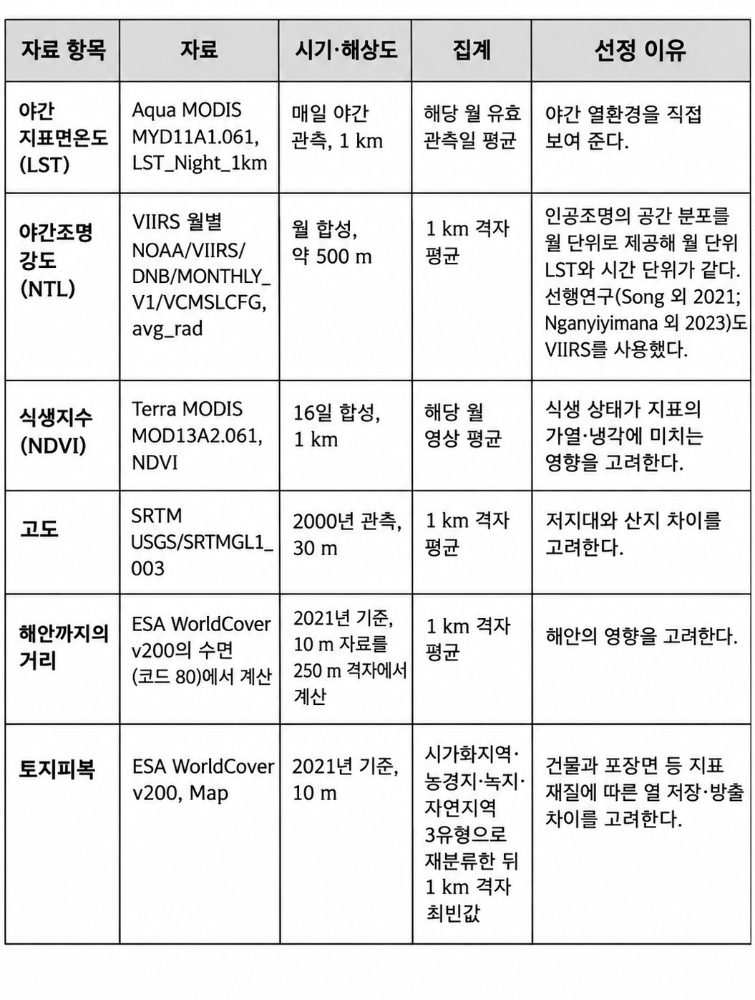
    <figcaption style="font-size: 0.9em; color: #555; margin-top: 8px;">사용 자료</figcaption>
  </figure>
</div>

<div style="display: flex; justify-content: center; margin: 20px 0;">
  <figure style="margin: 0; text-align: center; width: 48%;">
    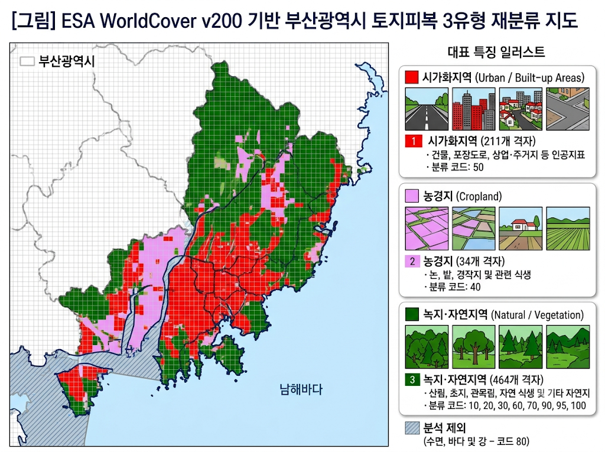
    <figcaption style="font-size: 0.9em; color: #555; margin-top: 8px;">토지피복 3유형 재분류 지도</figcaption>
  </figure>
</div>

### 4.3 자료의 품질 기준
ㆍLST: 품질 비트가 "양호" 또는 "보통"인 관측만 사용하고 구름 등으로 값이 생성되지 않은 관측은 제외했다. 값은 켈빈에서 섭씨로 변환하고, 월 유효 관측일 수(n_valid)를 함께 저장했다.  
ㆍNDVI: 품질 지표(SummaryQA)가 0~1인 영상만 사용하고 ×0.0001로 척도를 변환했다.  
ㆍ토지피복: WorldCover 클래스를 시가화지역(50), 농경지(40), 녹지·자연지역(10, 20, 30, 60, 70, 90, 95, 100)으로 묶었고 수면(80)은 분석에서 제외했다.  

### 4.4 분석 자료의 구성
ㆍ전처리(방법 절 참고) 후 분석 자료는 32,719행, 709격자, 48연월이다.   
ㆍ토지피복별 격자 수: 녹지·자연지역 464, 시가화지역 211, 농경지 34  
ㆍ기술통계(평균 ± 표준편차, 범위)
 - 야간 LST: 10.2 ± 8.5 °C (−7.2~26.0)
 - 월 유효 관측일 수: 9.6 ± 5.1일 (1~27)
 - NTL: 24.2 ± 23.3 nW/cm²/sr (0~220.8)
 - NDVI: 0.55 ± 0.20 (0.05~0.98)
 - 고도: 125.5 ± 118.9 m (0.8~626.3)
 - 해안 거리: 6.9 ± 4.1 km (0.4~17.1)

### 4.5 자료의 한계
ㆍ해안 거리는 큰 하천(낙동강 등)도 수면으로 보므로 "가장 가까운 큰 수면까지의 거리"에 가깝다.  
ㆍ토지피복은 2021년 한 시점의 지도이며 연구 기간 동안 변하지 않는다고 가정했다.  
ㆍNDVI는 Terra의 16일 합성(주간 관측)이고 LST와 NTL은 야간 관측이라 시각과 합성 기간이 같지 않다.  
ㆍ약 500 m의 VIIRS와 30 m의 고도 자료를 1 km로 평균하면 격자 내부의 변이가 사라진다.  
ㆍLST 월평균은 유효 관측일 수가 적을수록 불확실하며, 이는 방법 절의 기준별 민감도 분석으로 평가한다.  

## 5. 방법 {#method}

### 5.1 자료 처리와 기초 탐색

기준 격자는 MODIS Aqua LST의 1 km 격자이다. 해상도가 다른 VIIRS·SRTM·WorldCover 자료는 이 격자에 평균 집계해 투영을 맞췄고, 평균이 의미 없는 토지피복은 격자 안의 최빈값을 취했다. 해안 거리는 WorldCover 수면 마스크(250 m 격자, 수면 비율 0.5 초과)에서 유클리드 거리(최대 30 km)를 계산해 1 km로 집계했다.

전처리는 다음 순서로 하였다. 추출 원자료 36,864행(768격자 × 48연월)에서 육지 비율 0.8 미만의 격자를 제외해 34,032행(709격자)을 남겼다. 수면이 섞인 격자는 LST와 조명 값이 혼합되어 해석이 어렵기 때문이다. 이어서 LST·NTL·NDVI·고도·해안 거리·토지피복 중 하나라도 결측인 행을 보간 없이 제거해 32,719행을 남겼다. 토지피복이 3개 유형이 아닌 행과 격자 수 100 미만인 달은 제외하도록 했으며 이번 자료에서는 해당이 없었다. 마지막으로 월 유효 관측일 수 3일 이상을 기본 기준으로 적용해 31,222행을 분석 표본으로 삼았다. 월평균을 단일 관측이 아닌 복수 관측으로 만들기 위한 기준이며, 이 기준의 영향은 세부목적 3에서 평가한다. 기준 적용 후 한 달에 격자가 30개 미만이면 연월 평균이 불안정해지고 소수 표본이 추정을 왜곡할 수 있으므로 그 달을 제외했다. 계절은 봄(3~5월), 여름(6~8월), 가을(9~11월), 겨울(12·1·2월, 같은 달력연도)로 나눴다.

<div style="display: flex; justify-content: center; margin: 20px 0;">
  <figure style="margin: 0; text-align: center; width: 60%;">
    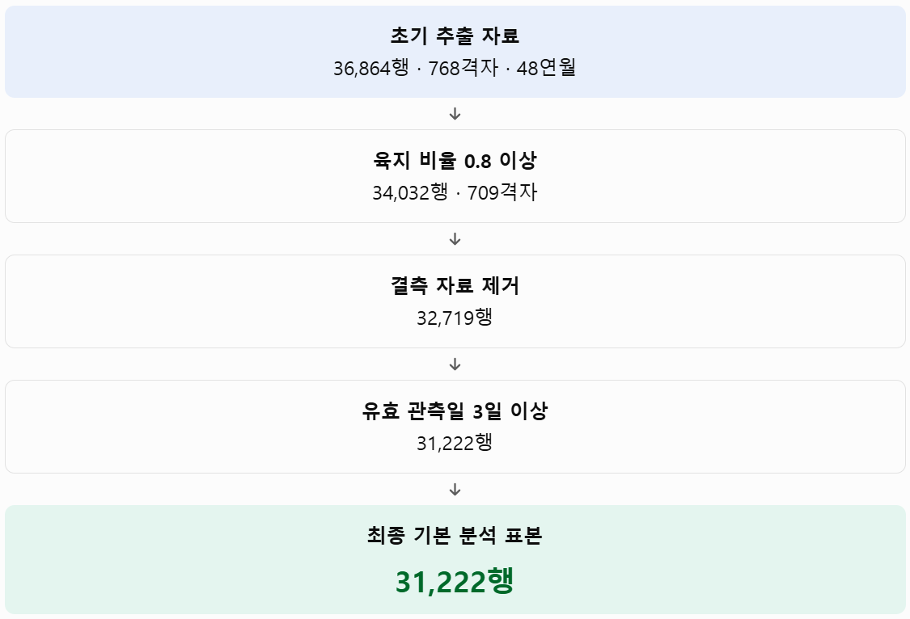
    <figcaption style="font-size: 0.9em; color: #555; margin-top: 8px;">전처리 흐름</figcaption>
  </figure>
</div>
NTL은 오른쪽으로 치우쳐 있어 ln(1+NTL)로 변환했다. 시기에 따른 온도 차이가 공간 비교에 섞이지 않도록 모든 변수에서 연월 평균을 뺐다(연월 고정효과를 넣은 회귀와 같다). 연속형 설명변수는 전체 자료에서 한 번 구한 표준편차로 나눠 표준화했으므로, 계수는 "1 SD당 LST 차이(°C)"이며 계절과 기준이 달라도 직접 비교할 수 있다.

```text
 x̃_it = x_it − x̄_t        (i: 격자, t: 연월)
 z_it = x̃_it / s_x         (s_x: 전체 자료의 x̃ 표준편차)
```

토지피복은 시가화지역(U)과 농경지(C) 더미(기준: 녹지·자연지역)로 넣었고 더미도 연월 평균을 뺐다.

기초 탐색으로 연월 평균을 제거한 ln NTL과 LST의 산점도를 그리고, 연월별 Pearson·Spearman 상관계수를 계산해 달에 따라 관계의 강도가 어떻게 달라지는지 확인했다. 이는 기술 목적이며 환경조건의 영향을 고려한 결과가 아니다.

### 5.2 세부목적 1의 분석: 환경조건 고려 전후의 관계

같은 표본(기본 기준 3일)에서 최소제곱법으로 세 모형을 추정했다. 모형 A는 야간조명만, 모형 B는 해안 거리·고도·NDVI·토지피복만, 모형 C는 여기에 야간조명을 더한 것이다. 세 모형은 시간 효과와 격자 구성이 같으므로 야간조명 계수의 변화와 R²의 차이는 변수 구성의 차이만 반영한다. 비교 지표는 모형 A와 C의 야간조명 계수(°C/SD)와 95% 신뢰구간, 그리고 야간조명을 추가했을 때 같은 연월 안의 격자 간 LST 차이에 대한 설명력의 증가분 ΔR²이다. R²는 연월 평균을 뺀 값 기준이다.

  ```text
  모형 A: LST ~ NTL
  모형 B: LST ~ 해안거리 + 고도 + NDVI + 시가화 + 농경지
  모형 C: LST ~ NTL + 해안거리 + 고도 + NDVI + 시가화 + 농경지
  ΔR² = R²(모형 C) − R²(모형 B)
```

모형은 선형·가법적 관계를 가정한다. 변수 간 겹침은 분산팽창계수(VIF)로 확인했다. 환경변수의 계수는 야간조명 계수를 보정하기 위한 것이며 인과효과로 해석하지 않는다.

### 5.3 세부목적 2의 분석: 계절별 관계

세부목적 1의 모형 C를 계절별로 추정해 계절별 야간조명 계수 β_s와 ΔR²를 구했다. 계절 간 차이와 그 구간은 모든 변수를 계절 더미와 교호시킨 하나의 모형에서 계산했다. 같은 격자가 여러 계절에 반복 관측되므로 따로 추정한 값끼리 빼면 계수 사이의 공분산을 반영할 수 없기 때문이다. 이 모형의 계절별 계수는 따로 추정한 값과 일치하는지 확인했다. 계절별 계수가 모두 같다는 가설은 Wald 검정으로 평가했다.

$$
\begin{aligned}
\text{LST} &\sim \sum_{s} \text{계절}_{s} \times \left( \beta_{s} \cdot \text{NTL} + \boldsymbol{\gamma}_{s}' \cdot \text{환경변수} \right) \\[12pt]
\Delta_{s,s'} &= \beta_{s} - \beta_{s'} \\[12pt]
H_{0}: &\ \beta_{\text{봄}} = \beta_{\text{여름}} = \beta_{\text{가을}} = \beta_{\text{겨울}}
\end{aligned}
$$


### 5.4 세부목적 3의 분석: 최소 유효 관측 일수 민감도

위성 자료의 품질 선별 기준이 결과에 주는 영향을 확인하기 위해 민감도 분석을 하였다. 기준 k = 1, 3, 5, 7, 10일마다 표본 {(i,t) : n_valid ≥ k}를 다시 고르고, 세부목적 2와 같은 모형·같은 표준화 값으로 계절별 계수를 재추정했다. 표준화 기준을 고정한 것은 표본이 달라져도 계수의 단위가 변하지 않게 하기 위해서이다. 각 기준의 표본 수와 계수, 구간을 제시하고, 기준이 엄격해질수록 표본 수가 줄어드는 추이를 함께 비교했다. 민감도는 부호 유지 여부, 구간의 0 포함 여부, 기본 기준 대비 변화량 Δβ_{s,k} = β_{s,k} − β_{s,3}로 평가했다. 계절별 모형은 표본이 100행 미만이거나 연월이 3개 미만이면 추정하지 않도록 했다.

기준이 엄격해지면 포함되는 격자와 연월도 달라지므로 계수 변화는 관측 정확도의 영향과 표본 구성의 영향이 섞여 있다. 따라서 기준별 신뢰구간의 겹침으로 차이를 판단하지 않고 부호와 크기의 변화를 중심으로 해석했다.

### 5.5 불확실성 및 재현성

같은 격자의 반복 관측은 독립이 아니므로 모든 모형에서 격자 단위 군집 표준오차를 사용했고, 95% 신뢰구간은 정규분포 근사로 계산했다. 이 구간은 인접 격자 사이의 공간 자기상관을 반영하지 못해 좁게 추정될 수 있다. 또한 현재 표본과 모형을 전제로 한 근사이며, 결과는 인과가 아니라 관측된 연관성이다.

코드는 Google Colab에서 Python, Google Earth Engine, statsmodels를 사용해 작성했다. 설정은 분석 기간 2022~2025, 육지 비율 0.8, LST 품질 "양호+보통", 기준 후보 1·3·5·7·10일(기본 3일)이다. 실행 순서는 경계 생성, 격자 변수 생성, 월별 추출(CSV 저장), 전처리, 세부목적 1·2·3 순이다. 추출 단계에서는 구·군이 16개이고 경계 면적이 650~950 km²인지, 시험 추출의 격자 수와 변수 채움 비율, 저장 파일의 월별 격자 수를 자동으로 점검한다. 추출 방식을 바꾼 경우에는 저장 파일을 쓰지 않고 다시 추출하도록 옵션을 두었다. Earth Engine 자료는 갱신될 수 있어 추출 날짜와 라이브러리 버전을 함께 기록한다.

## 6. 결과 {#results}

### 6.1 기초 탐색: 야간조명과 야간 LST의 월별 상관
**대응 연구 질문:** 환경조건을 고려하기 전, 같은 연월 안에서 야간조명과 야간 LST는 어떤 방향의 관계를 보이는가? (기술 목적이며 연구 질문 1~3에 직접 답하는 결과는 아니다.)  

최소 유효 관측 일수 3일 이상 기준을 적용한 분석 표본은 31,222행(709격자, 48연월)이다. 연월 평균을 제거한 ln(NTL+1)과 야간 LST를 비교하면, 야간조명 강도가 높은 관측값일수록 야간 LST 편차도 높은 경향이 나타났다.
<div style="display: flex; justify-content: center; margin: 20px 0;">
  <figure style="margin: 0; text-align: center; width: 60%;">
    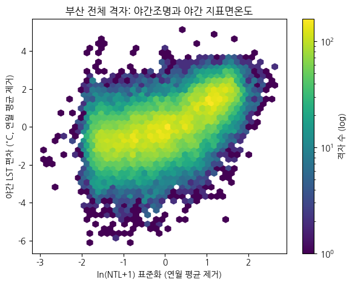
    <figcaption style="font-size: 0.9em; color: #555; margin-top: 8px;"></figcaption>
  </figure>
</div>

**그림 1.** 연월 평균을 제거한 ln(NTL+1)(표준화)과 야간 LST 편차(°C)의 육각 빈도 산점도. 색은 격자·연월 수(로그 척도)이며 표본은 31,222행이다. 환경조건을 고려하지 않은 기술적 비교이다.  
연월별 상관계수는 48개 연월 모두 양(+)이었다. Pearson 상관계수는 평균 0.554(최소 0.144, 최대 0.846), Spearman 상관계수는 평균 0.565(최소 0.157, 최대 0.846)였다.
<div style="display: flex; justify-content: center; margin: 20px 0;">
  <figure style="margin: 0; text-align: center; width: 80%;">
    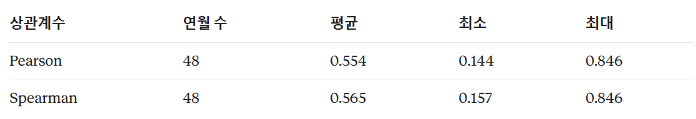
    <figcaption style="font-size: 0.9em; color: #555; margin-top: 8px;"></figcaption>
  </figure>
</div>

**표 1.** ln(NTL+1)과 야간 LST의 같은 연월 내 상관계수를 연월별로 계산한 뒤 48개 값을 요약했다. 환경조건을 고려한 결과가 아니다.

### 6.2 세부목적 1 · 환경조건을 고려한 야간조명과 야간 LST의 관계
**대응 연구 질문:** 해안까지의 거리, 고도, 토지피복, NDVI를 고려했을 때 야간조명 강도와 야간 LST는 어떤 방향과 크기의 관계를 보이는가? (연구 질문 1)  

 같은 표본(31,222행, 709격자, 48연월)에서 야간조명 계수는 보정 전(모형 A) 0.764°C/SD(95% 구간 0.714~0.814), 보정 후(모형 C) 0.806°C/SD(0.729~0.884)였다. 두 계수 모두 양(+)이었고 구간이 0을 포함하지 않았다. 환경변수를 추가한 후 야간조명 계수는 0.042°C/SD 증가했으며, 보정 전 계수 대비 약 5.5% 높은 값으로 나타났다. 연월 평균을 제거한 야간 LST의 표준편차는 1.400°C이며, 보정 후 계수는 이 값의 약 0.58배이다.
<div style="display: flex; justify-content: center; margin: 20px 0;">
  <figure style="margin: 0; text-align: center; width: 100%;">
    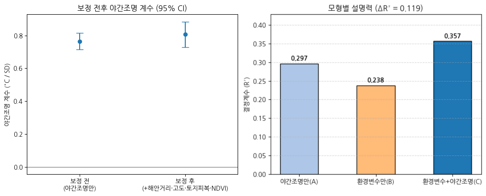
    <figcaption style="font-size: 0.9em; color: #555; margin-top: 8px;"></figcaption>
  </figure>
</div>

**그림 2.** 왼쪽은 보정 전(모형 A)과 보정 후(모형 C)의 야간조명 계수(°C/SD)와 95% 군집 신뢰구간이며 회색선은 0이다. 오른쪽은 모형 A(야간조명만), 모형 B(환경변수만), 모형 C(환경변수+야간조명)의 R²이다. 모든 모형은 연월 평균을 제거한 값으로 같은 표본에서 추정했다.  
R²는 모형 A 0.297, 모형 B 0.238, 모형 C 0.357이었다. 환경변수만 넣은 모형에 야간조명을 추가한 ΔR²는 0.119였다(연월 평균을 제거한 값 기준).
<div style="display: flex; justify-content: center; margin: 20px 0;">
  <figure style="margin: 0; text-align: center; width: 80%;">
    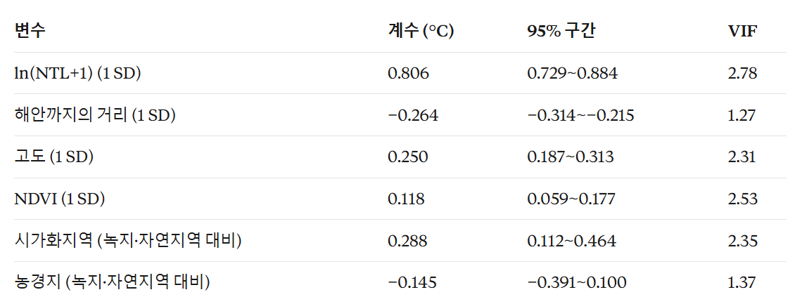
    <figcaption style="font-size: 0.9em; color: #555; margin-top: 8px;"></figcaption>
  </figure>
</div>

**표 2.** 모형 C의 계수(연월 평균 제거 후 추정, 군집 표준오차 기준 95% 구간)와 분산팽창계수(VIF). 연속형 변수는 1 SD당 LST 차이(°C), 토지피복은 기준범주(녹지·자연지역) 대비 차이(°C)이다. 환경변수의 계수는 야간조명 계수를 보정하기 위한 값이며 인과효과로 해석하지 않는다.  
분산팽창계수는 모든 변수에서 3 미만이었다. 농경지 계수의 구간은 0을 포함했고 나머지 변수의 구간은 0을 포함하지 않았다.  
동일한 표본에서 환경조건을 고려한 뒤에도 야간조명 계수는 양(+)이었으며, 야간조명 추가에 따른 표본 내 설명력 증가분은 0.119였다.

### 6.3 세부목적 2 · 계절별 연관성의 이질성 {#deep-seasonality}

**대응 연구 질문:** 환경조건을 고려한 야간조명 강도와 야간 LST의 관계는 봄·여름·가을·겨울에 어떻게 다른가? (연구 질문 2)

계절별 표본은 봄 7,248행, 여름 7,568행, 가을 8,038행, 겨울 8,368행이며 모든 계절에서 709격자, 12연월이었다. 환경조건을 고려한 야간조명 계수는 네 계절 모두 양(+)이었고 구간이 0을 포함하지 않았다. 계수는 봄 1.034, 가을 0.833, 여름 0.801, 겨울 0.658°C/SD 순으로 컸다.
<div style="display: flex; justify-content: center; margin: 20px 0;">
  <figure style="margin: 0; text-align: center; width: 100%;">
    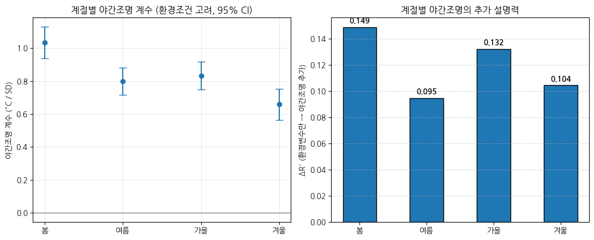
    <figcaption style="font-size: 0.9em; color: #555; margin-top: 8px;"></figcaption>
  </figure>
</div>

**그림 3.** 왼쪽은 계절별 야간조명 계수(°C/SD)와 95% 군집 신뢰구간이며 회색선은 0이다. 오른쪽은 계절별 ΔR²(환경변수만 → 야간조명 추가)이다. 모든 계절에 세부목적 1의 모형 C와 전체 기간 기준 표준편차를 적용했다.
<div style="display: flex; justify-content: center; margin: 20px 0;">
  <figure style="margin: 0; text-align: center; width: 80%;">
    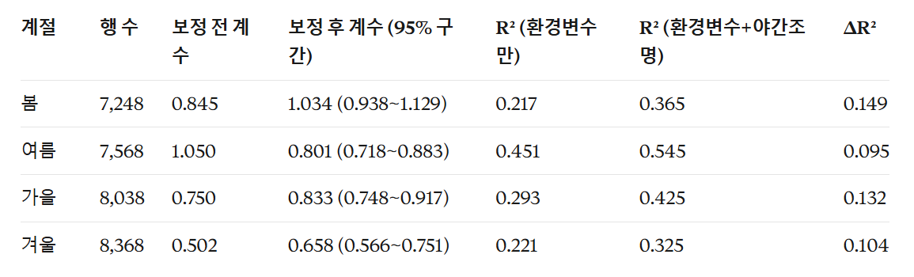
    <figcaption style="font-size: 0.9em; color: #555; margin-top: 8px;"></figcaption>
  </figure>
</div>

**표 3.** 계절별 야간조명 계수(°C/SD)와 R². 보정 후는 해안까지의 거리, 고도, 토지피복, NDVI를 고려한 값이다. 모든 계절은 709격자, 12연월이다.  
보정 전 계수는 여름(1.050)이 가장 컸고, 보정 후에는 봄(1.034)이 가장 컸다. 환경변수만 넣은 모형의 R²는 여름이 0.451로 가장 높았다. ΔR²는 봄 0.149, 가을 0.132, 겨울 0.104, 여름 0.095 순이었다.
<div style="display: flex; justify-content: center; margin: 20px 0;">
  <figure style="margin: 0; text-align: center; width: 80%;">
    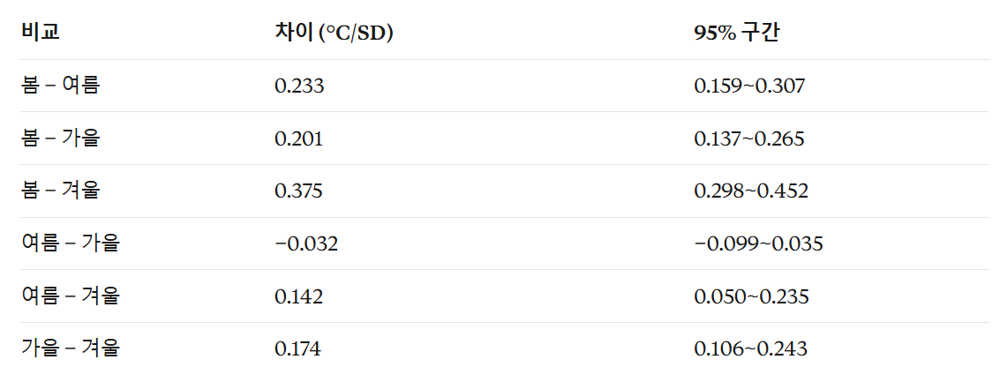
    <figcaption style="font-size: 0.9em; color: #555; margin-top: 8px;"></figcaption>
  </figure>
</div>

**표 4.** 모든 변수를 계절 더미와 교호시킨 하나의 모형에서 계산한 계절 간 계수 차이와 95% 군집 신뢰구간(같은 격자의 반복 관측에 따른 공분산 반영).  
이 모형의 계절별 계수와 개별 추정 계수의 최대 차이는 2.3×10⁻¹⁵였다. 여섯 쌍의 차이 중 여름−가을만 구간이 0을 포함했고(−0.032, −0.099~0.035), 나머지 다섯 쌍은 포함하지 않았다. 계절별 계수가 모두 같다는 가설의 Wald 검정은 χ²(3)=107.27, p<0.001이었다.
계절별 관계의 크기는 같지 않았으며, 봄과 겨울의 차이는 확인된 반면 여름과 가을의 차이는 구분하기 어려웠다.

### 6.4 세부목적 3 · 최소 유효 관측 일수 기준에 대한 민감도

**대응 연구 질문:** 최소 유효 관측 일수 기준을 바꾸었을 때, 환경조건을 고려한 계절별 야간조명–야간 LST 관계 추정치는 얼마나 달라지는가? (연구 질문 3)

기준을 1, 3, 5, 7, 10일로 바꾸면 격자·연월 표본 수가 줄었다. 가장 느슨한 기준(1일)에서 가장 엄격한 기준(10일)으로 바뀔 때 표본 수는 봄 8,165→2,783행, 여름 7,959→1,902행, 가을 8,166→4,206행, 겨울 8,429→6,006행이었다. 10일 기준에서 남은 격자·연월은 봄 467격자·11연월, 여름 513격자·9연월, 가을 690격자·10연월, 겨울 689격자·12연월이었다.
<div style="display: flex; justify-content: center; margin: 20px 0;">
  <figure style="margin: 0; text-align: center; width: 100%;">
    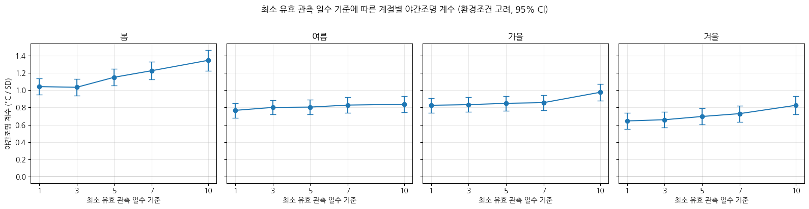
    <figcaption style="font-size: 0.9em; color: #555; margin-top: 8px;"></figcaption>
  </figure>
</div>

**그림 4.** 최소 유효 관측 일수 기준(1·3·5·7·10일)에 따른 계절별 야간조명 계수(°C/SD)와 95% 군집 신뢰구간이며 회색선은 0이다. 모든 기준에 세부목적 2와 같은 모형 및 전체 기간 기준 표준편차를 적용했다. 기본 기준은 3일이다.
<div style="display: flex; justify-content: center; margin: 20px 0;">
  <figure style="margin: 0; text-align: center; width: 80%;">
    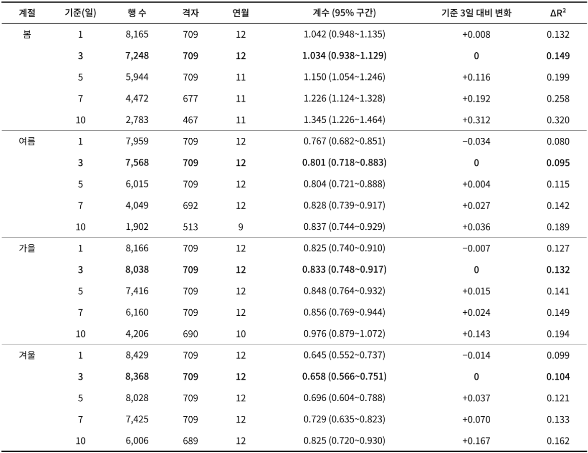
    <figcaption style="font-size: 0.9em; color: #555; margin-top: 8px;"></figcaption>
  </figure>
</div>

**표 5.** 기준별 계절 모형의 표본 수와 야간조명 계수(°C/SD). 변화량은 같은 계절의 기본 기준(3일) 계수와의 차이(Δβ)이다. 계수는 해안까지의 거리, 고도, 토지피복, NDVI를 고려한 값이다.

20개 계절·기준 조합 모두에서 계수의 부호는 양(+)이었고 구간이 0을 포함하지 않았다. 기준 3일 대비 계수의 최대 변화량은 봄 0.312, 겨울 0.167, 가을 0.143, 여름 0.036이었다. 계수의 범위는 여름이 0.767~0.837로 가장 좁았고 봄이 1.034~1.345로 가장 넓었다. 기준 3일부터 5·7·10일로 엄격해질수록 네 계절 모두 계수와 ΔR²가 커졌다. 계절별 계수의 순서(봄>가을>여름>겨울)는 1일부터 10일까지 다섯 기준에서 모두 같았다. 계절별 기준 변화에 따른 부호와 크기 변화를 중심으로 비교했으며, 신뢰구간의 겹침은 판단 기준으로 사용하지 않았다. 기준이 엄격해질수록 분석 표본이 감소했으며, 일부 계절에서는 분석 대상 격자와 연월 구성도 달라졌다.
관측일 기준을 바꾸어도 양(+)의 방향은 유지됐지만, 계수의 크기는 특히 봄에서 변화했고 엄격한 기준에서는 분석 표본도 크게 줄었다.

## 7. 토의 {#discussion}

### 7.1 야간조명의 추가 설명력과 계절별 관계

같은 연월의 부산 격자를 비교한 결과, 야간조명 강도가 높은 곳일수록 야간 지표면온도(LST)도 높은 양의 관계가 나타났다. 해안까지의 거리, 고도, 토지피복, 식생지수(NDVI)를 고려한 뒤에도 야간조명 계수는 0.806°C/SD로 양의 값을 유지했다. 환경변수만 포함한 모형에 야간조명을 추가했을 때 결정계수는 0.238에서 0.357로 증가했다(ΔR²=0.119). 이는 분석 표본에서 야간조명이 해당 환경변수들만으로 설명되지 않는 격자 간 야간 LST 차이에 관한 정보를 제공했음을 뜻한다.

이 관계의 크기는 계절마다 같지 않았다. 환경조건을 고려한 야간조명 계수는 봄 1.034°C/SD로 가장 크고 겨울 0.658°C/SD로 가장 작았다. 계절별 계수가 모두 같다는 가설도 기각되었다. 다만 여름과 가을의 계수 차이에 대한 95% 신뢰구간은 0을 포함하므로, 두 계절의 관계 크기를 뚜렷하게 구분하기는 어렵다. 야간조명을 추가했을 때의 설명력 증가분 역시 봄에 가장 컸다(ΔR²=0.149). 따라서 연중 관계를 하나의 계수로만 요약하면 계절별 차이를 충분히 보여주기 어렵다.

최소 유효 관측 일수 기준을 1·3·5·7·10일로 바꾸어도 모든 계절에서 야간조명 계수는 양의 값을 유지했고, 계수의 순서도 봄·가을·여름·겨울로 같았다. 그러나 방향이 유지된다는 것과 계수의 크기가 일정하다는 것은 다르다. 봄 계수는 기본 3일 기준의 1.034°C/SD에서 10일 기준의 1.345°C/SD로 증가했고, 같은 기간 봄의 표본은 7,248행에서 2,783행으로 줄었다. 따라서 봄의 양의 관계는 관측 일수 기준을 바꾸어도 확인되지만, 그 크기를 해석할 때는 자료 선별에 따른 표본 변화도 고려해야 한다.

### 7.2 봄철 관계가 크게 나타난 가능한 이유

봄철에는 일사와 식생 상태가 변화하는 가운데, 낮 동안 지표에 저장된 열이 밤에 방출되는 양상이 시가화지역과 녹지·자연지역에서 다르게 나타났을 가능성이 있다. 이로 인해 야간조명이 집중된 지역과 그렇지 않은 지역의 같은 연월 내 격자 간 온도 차이가 봄에 상대적으로 뚜렷했을 수 있다. Shi et al.(2022)은 베이징에서 지표 유형별 LST 분포가 계절과 주·야간에 따라 달라짐을 보여주었다. 이 연구는 계절별 지표 조건을 고려할 필요성을 뒷받침하지만, 부산에서 봄철 야간조명 계수가 가장 크게 나타난 원인을 직접 입증하지는 않는다.

겨울의 계수가 작게 추정된 데에도 일사, 지표의 열 저장·방출, 바람 등 계절별 조건의 차이가 관여했을 가능성이 있다. 다만 분석에서 연월 평균을 제거했으므로, 겨울의 기온이 전반적으로 낮다는 사실만으로 봄과 겨울의 계수 차이를 설명할 수는 없다. 여기서 비교한 것은 계절별 평균온도가 아니라 각 연월 안에서 야간조명 강도 차이에 대응하는 격자 간 LST 차이의 기울기다.

본 연구에서는 계절별 일사량이나 지표면의 열적 특성을 직접 분석하지 않았다. 따라서 봄철 계수가 크게 나타난 것이 지표의 열 저장·방출 차이 때문인지, 계절별 관측 조건과 표본 구성 등 다른 요인 때문인지는 구분하기 어렵다. 봄철의 높은 계수는 계절별 관계의 차이를 보여주는 결과로 해석하되, 그 원인을 특정하려면 추가 분석이 필요하다.

환경변수를 추가한 뒤 전체 기간의 야간조명 계수가 0.764에서 0.806°C/SD로 소폭 커진 점도 특정 환경변수 하나의 작용으로 설명하기는 어렵다. 조명이 밝은 지역은 지형·피복·식생 조건에서도 다른 지역과 차이가 있으며, 이 조건들을 함께 고려하면서 추정된 관계의 크기가 달라진 것으로 해석할 수 있다. 이 변화가 야간조명이나 인간 활동의 독립적인 온도 상승 효과를 보여주는 것은 아니다.

### 7.3 선행연구와의 관계

부산에서 확인된 야간조명과 야간 LST의 양의 관계는 베이징·평양을 분석한 Song et al.(2021) 및 서울의 야간 열환경을 다룬 Nganyiyimana et al.(2023)의 결과와 방향성이 일치한다. 이는 야간조명이 도시의 야간 열환경 분포를 살펴보는 보조 지표로 활용될 가능성을 부산의 격자 자료에서도 보여준다.

다만 선행연구와 추정값의 크기를 직접 비교할 수는 없다. 특히 서울 연구는 지표면 도시열섬강도를 분석했고, 본 연구는 격자별 야간 LST 자체를 분석했다. 대상 도시, 분석 기간, 공간 단위와 고려한 환경조건도 다르다. 본 연구는 2022~2025년 부산의 약 1 km 격자에서 같은 연월의 공간적 차이를 비교하고, 지형·피복·식생을 고려한 뒤에도 야간조명이 추가 정보를 제공하는지, 그 관계가 계절과 자료 선별 기준에 따라 어떻게 달라지는지 확인했다는 점에서 선행연구를 확장한다.

### 7.4 해석의 한계와 활용 범위

그림 1에서는 조명 강도에 따라 LST가 증가하는 양상이 한 직선으로만 나타나지 않을 가능성도 보인다. 그러나 이 그림은 환경조건을 고려하기 전의 분포이며, 가로축에는 밝은 값의 간격을 압축하는 ln(NTL+1) 변환이 적용되어 있다. 따라서 그림의 형상만으로 비선형 관계를 확정할 수 없다. 본 연구의 회귀계수는 분석 범위의 관계를 하나의 직선으로 요약한 값이며, 모든 밝기 수준에서 동일한 기울기가 성립한다는 뜻은 아니다. 향후에는 같은 표본과 환경조건을 유지한 상태에서 선형 모형과 곡선형 모형을 비교할 필요가 있다.

자료 구축과 불확실성에도 제약이 있다. 보고서에서 ‘해안까지의 거리’로 부른 변수는 WorldCover의 수면에서 계산했으므로, 외해 해안선뿐 아니라 낙동강 등 큰 수면까지의 거리도 반영한다. 약 1 km 격자로 집계하면서 격자 내부의 건물·포장면·소규모 녹지 차이는 구분하기 어려워졌고, 2021년 토지피복을 연구 기간 전체에 적용했다. 격자 단위 군집 표준오차는 같은 격자의 반복 관측을 고려하지만 인접 격자 사이의 공간적 상관까지 반영하지는 못한다. 또한 유효 관측 일수 기준을 높이면 남는 격자와 연월의 구성이 달라지므로, 계수 변화에는 관측값의 안정성과 표본 선택의 영향이 함께 반영될 수 있다.

따라서 본 결과는 분석에 포함된 부산의 격자에서 관찰된 야간조명과 야간 LST의 공간적 연관성으로 해석해야 한다. 야간조명은 인공열이나 실제 사람의 활동량을 직접 측정하지 않으며, 높은 LST의 원인을 특정하거나 폭염 피해를 예측하는 지표로 곧바로 사용할 수 없다. 다만 기존 환경자료와 함께 지역별 야간 지표 열환경을 살펴보고, 추가 조사가 필요한 곳을 검토하는 보조 자료로 활용할 수 있다. 실제 대응 지역을 정하려면 현장 기온, 건물 형태, 인구와 취약계층 분포 등 목적에 맞는 자료를 함께 확인해야 한다.

## 8. 결론 {#conclusion}

본 연구는 합성자료를 이용하여 NDVI–LST 관계를 환경조건 보정, 계절별 이질성, 자료 선택 민감도 및 공간 예측 성능의 측면에서 평가하였다. 세부목적별 결론은 다음과 같다.

1. **세부목적 1 — 조건부 연관성.** NDVI 0.1 증가당 계수는 계절만 보정했을 때 −1.12°C, 환경조건을 추가했을 때 −0.57°C였다. 이 결과는 관계의 크기를 제시할 때 보정 조건을 명시해야 함을 보여주며, 녹지의 인과적 냉각 효과를 추정한 결과는 아니다.
2. **세부목적 2 — 계절별 이질성.** 봄과 여름의 기울기는 각각 −0.34°C와 −0.81°C였고, 여름−봄 차이는 −0.47°C(95% 구간 −0.64~−0.31°C)였다. 설정된 생성 구조와 모형 아래에서 하나의 공통 기울기만으로는 계절 차이를 충분히 나타내지 못하였다.
3. **세부목적 3 — 민감도와 예측 성능.** 세 품질 기준에서 여름 계수의 방향은 유지되었으나, 가장 엄격한 조건에서는 표본 수가 줄고 구간이 넓어졌다. NDVI와 교호작용 추가에 따른 블록 교차검증 RMSE 감소는 약 0.10°C였다. 관계 추정의 안정성과 예측 기여는 구분하여 판단할 필요가 있다.

이상의 결과는 연구 질문을 조건·추정량·평가 기준이 명시된 세부목적으로 구체화하고, 각 목적에 대응하는 근거와 한계를 제시하는 분석 절차를 예시한다. 실제 도시 환경에 대한 결론은 관측자료와 적절한 검증 설계에 기반한 후속 분석을 통해 별도로 도출해야 한다.

---

### 부록 · 재현성 및 연구 기여 {#reproduce}

#### 직접 실행하기

[Colab에서 합성자료 노트북 열기](https://colab.research.google.com/github/{{ site.github.owner_name }}/{{ site.github.repository_name }}/blob/main/02_개인분석/01_demo_analysis.ipynb)

심화 분석도 EE 인증 없이 실행됩니다. 공통 자료 준비 블록을 먼저 실행하고 해당 분석 셀을 따라가세요.

- [세부목적 1: 환경조건 보정 — Colab](https://colab.research.google.com/github/{{ site.github.owner_name }}/{{ site.github.repository_name }}/blob/main/02_개인분석/02_confounding.ipynb)
- [세부목적 2: 계절별 관계 — Colab](https://colab.research.google.com/github/{{ site.github.owner_name }}/{{ site.github.repository_name }}/blob/main/02_개인분석/03_seasonality.ipynb)
- [세부목적 3: 강건성·공간 검증 — Colab](https://colab.research.google.com/github/{{ site.github.owner_name }}/{{ site.github.repository_name }}/blob/main/02_개인분석/04_robustness.ipynb)

GitHub 저장소의 코드를 로컬에서 실행하려면 다음을 사용합니다.

```text
python -m pip install -r requirements.txt
python 01_공통코드/make_demo.py
python 01_공통코드/advanced_analysis.py
```

예시 합성 분석은 2026-10-26 로컬 환경에서 실행 확인했습니다. GEE 시작 노트북의 실제 서버 실행은 검증하지 않았습니다.

[별도 연습: GEE 시작 노트북](https://colab.research.google.com/github/{{ site.github.owner_name }}/{{ site.github.repository_name }}/blob/main/01_공통코드/01_gee_starter.ipynb)

#### 조원별 기여를 쓰는 방법

실제 조에서는 “조원 A: 공통 전처리 및 품질 점검 / 조원 B: 공간 비교 / 조원 C: 시계열 분석”처럼 **분석 내용과 연결된 기여**를 기록하세요. 위 역할은 작성 예시이며 실제 참여자 명단이 아닙니다. 별도 주간 보고서는 만들지 않아도 됩니다.

#### 자료와 참고

- 합성자료: 이 저장소의 생성 코드, seed 2026(기본), 20261026(심화). 외부 관측 데이터 사용 없음.
- [Landsat 8 Collection 2 Level-2 공식 자료 설명](https://developers.google.com/earth-engine/datasets/catalog/LANDSAT_LC08_C02_T1_L2)
- [학생 사용 안내]({{ site.github.repository_url }}/blob/main/STUDENT_GUIDE.md)
- [빈 보고서 틀](report-template.html)

- [섹션별 작성 지침]({{ site.github.repository_url }}/blob/main/05_보고서양식/섹션별_작성지침.md)


#### 연구 배경 참고문헌

- Voogt, J. A., & Oke, T. R. (2003). Thermal remote sensing of urban climates. *Remote Sensing of Environment, 86*(3), 370–384. [https://doi.org/10.1016/S0034-4257(03)00079-8](https://doi.org/10.1016/S0034-4257(03)00079-8).
- Schwaab, J., Meier, R., Mussetti, G., Seneviratne, S., Bürgi, C., & Davin, E. L. (2021). The role of urban trees in reducing land surface temperatures in European cities. *Nature Communications, 12*, 6763. [https://doi.org/10.1038/s41467-021-26768-w](https://doi.org/10.1038/s41467-021-26768-w).
